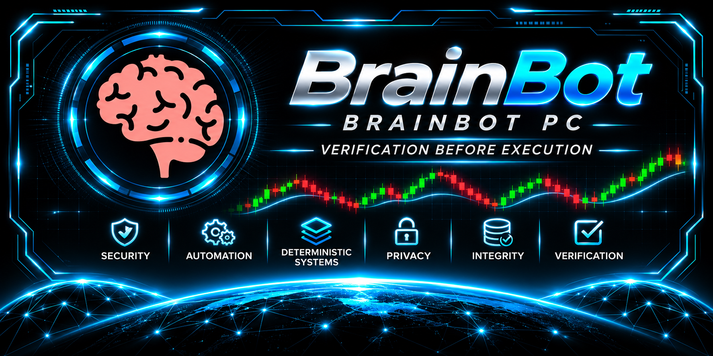

# BrainBot | BrainBot PC

**Independent Linux desktop software · Local-first design · Controlled access**

**ProcessOverProfit — Verification Before Execution**

BrainBot is a privately developed, local-first Ubuntu desktop application and user-facing control environment. Its intended purpose is to provide structured interaction with approved local resources while preserving user control and clear access boundaries.

It is a separate project within the [ProcessOverProfit engineering portfolio](https://github.com/processoverprofit-sys). This repository documents its purpose, design objectives and development history; it does not distribute the underlying application.

**Explore:** [Overview](#project-overview) · [Technical documentation](#technical-documentation) · [Development status](#development-status) · [Community](#join-the-processoverprofit-community) · [Public scope](#public-repository-scope)

---

## Project overview

| Area | Public description |
| --- | --- |
| Platform | Linux / Ubuntu desktop |
| Project type | Independent desktop application and user-facing control environment |
| Design approach | Local-first, security-conscious engineering |
| Source availability | Private; no public application release |
| Historical milestone | BrainBot PC 3.5.0–3.5.3 development line recorded as completed and frozen |
| Repository purpose | Public documentation, project identity and constructive feedback |

## Development priorities

- **Local-first design:** prioritise local ownership, privacy and user control.
- **Controlled access:** limit interaction to approved resources and permissions.
- **Clear component boundaries:** separate interface responsibilities from backend authority.
- **Reliability and maintainability:** use explicit requirements, controlled testing and documented limitations.
- **Security-conscious behaviour:** treat permission and validation failures explicitly rather than silently bypassing them.

These are design objectives, not assertions that every feature or control has been implemented, tested or independently verified.

**Start here:** [FAQ](docs/FAQ.md) · [Publication checklist](docs/PUBLICATION_CHECKLIST.md) · [Evidence template](docs/EVIDENCE_REPORT_TEMPLATE.md) · [Community conduct](CODE_OF_CONDUCT.md) · [Engineering HQ](https://github.com/processoverprofit-sys/Processoverprofit-sys)

## Technical documentation

| Document | What it explains |
| --- | --- |
| [Conceptual architecture](docs/ARCHITECTURE.md) | Intended responsibilities, local interaction and trust boundaries |
| [Development status](docs/DEVELOPMENT_STATUS.md) | Historical milestones, public status and limits of evidence |
| [Security principles](docs/SECURITY_PRINCIPLES.md) | Intended access, privacy and failure-handling objectives |
| [Testing and illustrative cases](docs/TESTING.md) | Proposed evaluation methodology and fictional, unexecuted examples |
| [Community and feedback](docs/COMMUNITY.md) | Constructive review questions and how to participate |

## Development status

The BrainBot PC 3.5.0–3.5.3 development line has been recorded as completed and frozen in Engineering HQ. The earlier Android direction has been discontinued.

This is a historical development-line milestone, not a claim that BrainBot is a publicly released product, that every intended feature is complete, or that the application has passed an independent security audit. No public executable or installation instructions are supplied.

The wider portfolio uses owner-led, AI-assisted engineering. AI assistance does not constitute independent human assurance. See the [development status](docs/DEVELOPMENT_STATUS.md) for the limits of the public record.

## Relationship to T-Bot

BrainBot provides a local user-facing environment. [T-Bot](https://github.com/processoverprofit-sys/T-Bot) is a separate trading-system research and engineering project with its own risk, signing and authorisation boundaries.

BrainBot is not an autonomous trading engine and does not provide an alternative route around those controls. Any future integration would require its own review and explicit authorisation.

## Join the ProcessOverProfit community

ProcessOverProfit has a dedicated Discord community for developers, Linux enthusiasts, project followers and people interested in learning together. GitHub repository notifications are connected to Discord.

Constructive feedback on local-first design, desktop usability, reliability, component responsibilities and testing is welcome. The [community guide](docs/COMMUNITY.md) explains the types of feedback that would be useful.

If you found the project through Reddit or another community discussion, you may request an invitation there where the community rules permit. Discord access is managed by the maintainer. No public invitation URL is listed, and joining the community does not grant private source or operational access.

For the wider portfolio, see the [Engineering HQ invitation-request guidance](https://github.com/processoverprofit-sys/Processoverprofit-sys/blob/main/docs/COMMUNITY.md#requesting-discord-access) and [public roadmap](https://github.com/processoverprofit-sys/Processoverprofit-sys/blob/main/docs/ROADMAP.md).

## Public repository scope

This is a **documentation-only repository**. It does not distribute private source code, executable software, internal configurations, credentials, wallet details, private evidence or operational infrastructure.

## Feedback and security

Non-sensitive documentation corrections may be proposed through public pull requests at the maintainer's discretion, subject to [CONTRIBUTING.md](CONTRIBUTING.md). Public Issues and GitHub Discussions are currently disabled.

Use the confidential reporting route in [SECURITY.md](SECURITY.md) for security concerns about this public repository. Do not post vulnerabilities, private information or unpublished implementation details publicly. No permission to access or test private systems is granted.

---

**Developed and used on Linux.**

**Process Over Profit — Verification Before Execution.**
