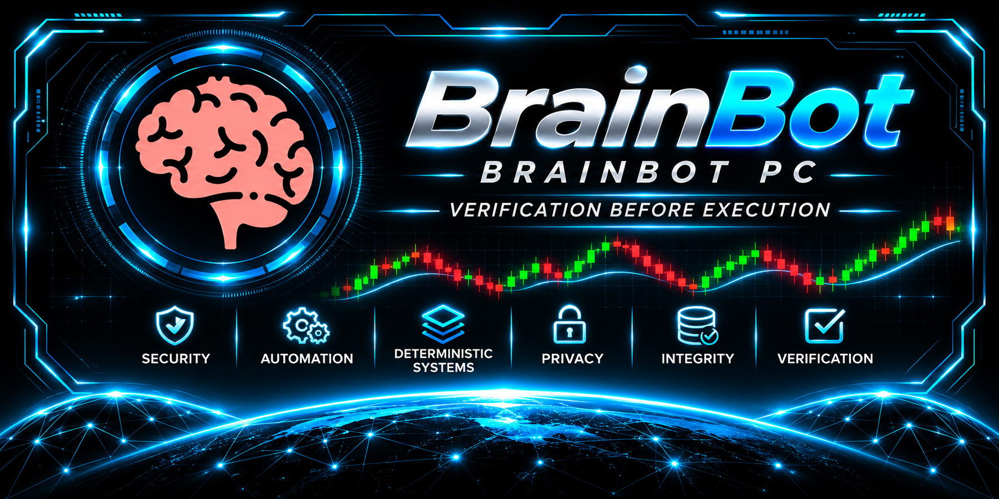

# BrainBot | BrainBot PC

**Independent Linux desktop software · Local-first design · Controlled access**

**ProcessOverProfit — Verification Before Execution**

BrainBot is a separate, independently developed Linux desktop software project. Public descriptions are intentionally limited while the underlying application remains private.

**Navigate:** [Overview](#project-overview) · [Development priorities](#development-priorities) · [Status](#public-status) · [Public scope](#public-repository-scope) · [Feedback](#feedback-and-security)

---

## Project overview

| Area | Public description |
| --- | --- |
| **Platform** | Linux / Ubuntu desktop |
| **Project type** | Independent desktop software |
| **Design approach** | Local-first, security-conscious engineering |
| **Source availability** | Private; no public application release |
| **Repository purpose** | Public documentation and project identity |

## Development priorities

- **Linux-focused development** and local-first design principles.
- **Reliability and maintainability**, supported by testing.
- **Controlled permissions** and clear component boundaries.
- **User-controlled interaction** and security-conscious documentation.

These are project priorities, **not assertions that specific features or controls have already been implemented or independently verified**.

## Public status

**Private software project.** The application source code is not publicly released. No production-readiness or general feature-completeness claim is made here.

The [Engineering HQ profile](https://github.com/processoverprofit-sys/Processoverprofit-sys) separately records the BrainBot PC 3.5.0–3.5.3 development line as completed and frozen; that historical development-line status should not be interpreted as a public product release or security certification.

## Public repository scope

This is a **documentation-only overview**. It does not contain private source code, executable software, internal configurations, credentials or unpublished implementation details.

BrainBot is separate from [T-Bot](https://github.com/processoverprofit-sys/T-Bot), which has its own trading, risk and authorization boundaries. BrainBot does not provide an alternative route around those controls.

## Feedback and security

General, non-sensitive feedback on Linux desktop application design, usability, reliability and documentation may be considered in the future. **Public Issues are currently disabled.** If enabled later, read [CONTRIBUTING.md](CONTRIBUTING.md) and [SECURITY.md](SECURITY.md) first.

Do not post vulnerabilities, credentials or private implementation details publicly.

---

**Developed and used on Linux.**

**Process Over Profit — Verification Before Execution.**
