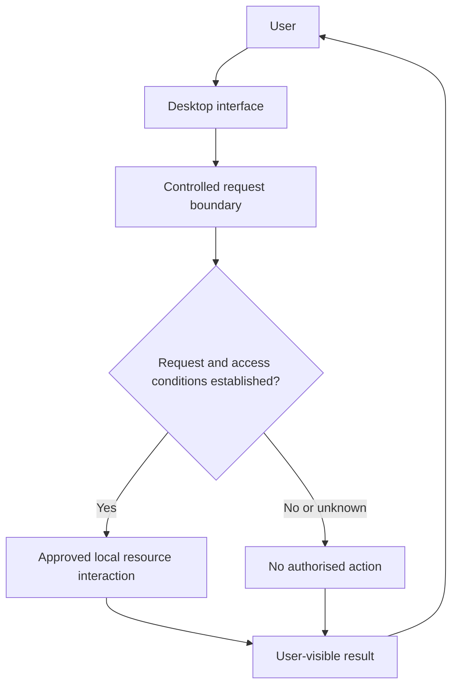

# Conceptual architecture

**Scope:** A public, illustrative model of intended responsibilities. This is not an as-built component diagram, implementation specification or security audit.

BrainBot is intended to provide structured user interaction with approved local resources in an Ubuntu desktop environment. The public Engineering HQ description identifies local-first interaction, controlled permissions, separation of interface and backend responsibilities, and user control as design priorities.

The following diagram expresses those priorities as conceptual boundaries for discussion. Its labels do not identify actual modules, processes, services, interfaces or implementation mechanisms.

## Conceptual responsibilities

| Responsibility | Intended behaviour |
| --- | --- |
| User interaction | Make requests and outcomes understandable to the user. |
| Desktop interface | Present information and interaction without assuming unrestricted backend authority. |
| Request boundary | Establish that a requested action and its access conditions are permitted. |
| Resource interaction | Remain limited to approved resources and the authority necessary for the request. |
| Result presentation | Communicate success, denial, failure or uncertainty without claiming an action succeeded when it did not. |

These are proposed responsibilities for review. The actual implementation and evidence remain private.

## Project separation

BrainBot and T-Bot are separate projects. BrainBot's intended user-facing responsibilities do not establish trading authority, signing permission or access to T-Bot's private resources.

Any future integration must preserve the independent authorisation boundaries of each project. This documentation neither describes an operational integration nor grants permission to create or exercise one.

## Review questions

- How can a desktop interface make permission boundaries understandable without exposing private configuration?
- What should a user be told when a requested action is denied or its outcome is uncertain?
- How should component responsibilities be described so that the interface cannot be mistaken for unrestricted backend authority?

See [security principles](SECURITY_PRINCIPLES.md) and [development status](DEVELOPMENT_STATUS.md).

[Return to BrainBot](../README.md)
